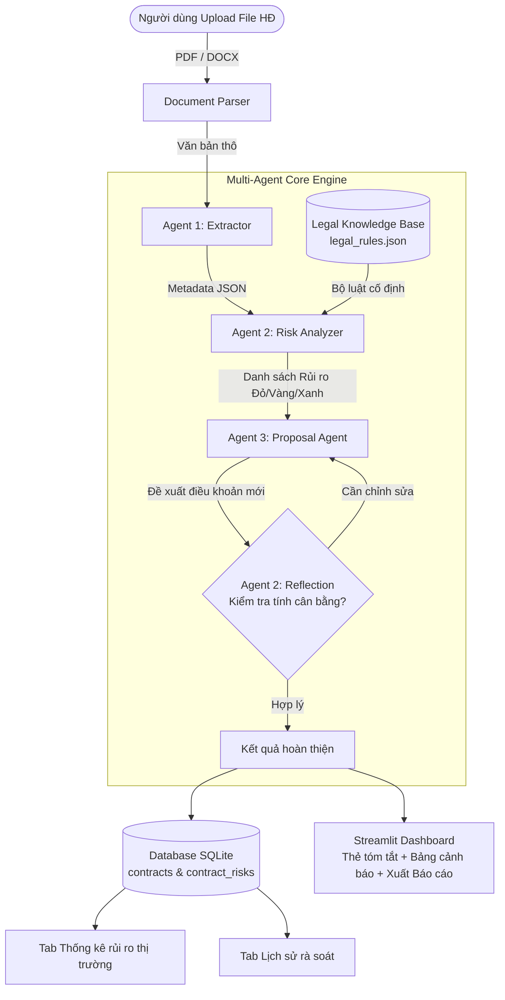

# KẾ HOẠCH CHI TIẾT 5 TUẦN (SPRINT PLAN)
## Đề tài: Hệ thống Multi-Agent Rà soát, Phát hiện Rủi ro & Đề xuất Điều khoản Hợp đồng Thuê nhà

- **Quy mô:** 1 người thực hiện
- **Thời lượng:** 5 tuần (35 ngày)
- **Công nghệ chính:** Python 3.10+, LangChain / LangGraph, Pydantic, SQLite, Streamlit, Google Gemini Flash API / OpenAI GPT-4o-mini.

---

## 🏛️ TỔNG QUAN KIẾN TRÚC HỆ THỐNG



---

## 📅 LỘ TRÌNH 5 TUẦN CHI TIẾT

### TUẦN 1: Thu thập Dữ liệu, Đóng gói Legal Knowledge Base & Thiết kế Ground Truth
> **Mục tiêu tuần:** Chuẩn bị trọn vẹn dữ liệu thử nghiệm, cố định bộ luật 100%, thiết lập môi trường và cấu trúc thư mục dự án.

- [ ] **Ngày 1 (Khởi tạo dự án & Môi trường):**
  - Khởi tạo Git repo, thiết lập virtual environment (`python -m venv venv`).
  - Cài đặt thư viện cốt lõi: `langchain`, `pydantic`, `streamlit`, `python-docx`, `pypdf`, `pdfplumber`, `google-genai` (hoặc `openai`), `sqlalchemy`.
  - Cấu hình quản lý biến môi trường (`.env`, `API_KEY`).
  - Thiết kế cấu trúc thư mục module hóa sạch sẽ:
    ```text
    rental-contract-multiagent/
    ├── data/
    │   ├── raw_contracts/       # 15-20 hợp đồng mẫu
    │   ├── legal_rules.json     # Bộ luật đóng kín
    │   └── ground_truth.json    # Nhãn chuẩn để tính metric
    ├── src/
    │   ├── agents/              # extractor, analyzer, proposal
    │   ├── database/            # sqlite models & connection
    │   ├── parsers/             # docx & pdf extraction
    │   └── utils/
    ├── app.py                   # Streamlit app chính
    ├── evaluate.py              # Script chạy benchmark metrics
    └── requirements.txt
    ```

- [ ] **Ngày 2–3 (Thu thập & Chuẩn hóa 15–20 Hợp đồng):**
  - Thu thập 5 hợp đồng mẫu chuẩn từ các đơn vị quản lý vận hành / môi giới uy tín.
  - Thu thập 10 hợp đồng thực tế từ sinh viên, người đi làm thuê trọ (đã che thông tin cá nhân).
  - Tự tạo 5 hợp đồng tổng hợp có "cài cắm" các bẫy tinh vi (phạt cọc 100%, tăng giá điện nước tùy ý, tự ý vào phòng,...).
  - Chuẩn hóa định dạng lưu trữ (PDF text-based và DOCX).

- [ ] **Ngày 4–5 (Xây dựng Bộ quy tắc luật đóng kín `legal_rules.json`):**
  - Biên soạn ~20 quy tắc rủi ro cốt lõi dựa trên **Bộ luật Dân sự 2015** và **Luật Nhà ở 2023**.
  - Phân loại rõ: *Vi phạm pháp luật* vs *Bất lợi thương mại*.
  - Định nghĩa từng Rule đầy đủ: `rule_id`, `category`, `legal_basis`, `risk_level` (RED/YELLOW/GREEN), `trigger_condition`, `standard_clause`.

- [ ] **Ngày 6–7 (Gắn nhãn Ground-Truth cho tập dữ liệu):**
  - Tạo file `data/ground_truth.json` gắn nhãn thủ công cho 15–20 hợp đồng.
  - Khai báo rõ trong từng hợp đồng: Các trường cần trích xuất (giá, cọc, hạn HĐ) và Danh sách các rủi ro thực tế có trong văn bản (đoạn text vi phạm + rule_id tương ứng).
  - **Milestone 1:** Dữ liệu thử nghiệm, bộ luật và nhãn chuẩn đã sẵn sàng 100%.

---

### TUẦN 2: Xây dựng Parser, Database SQLite & Agent 1 (Extractor)
> **Mục tiêu tuần:** Hoàn thành module đọc văn bản, dựng database lưu vết và Agent 1 trích xuất dữ liệu có cấu trúc.

- [ ] **Ngày 8–9 (Module Parser văn bản):**
  - Viết `src/parsers/docx_parser.py`: Trích xuất text có thứ tự từ DOCX (`python-docx`).
  - Viết `src/parsers/pdf_parser.py`: Trích xuất text từ PDF text-based (`pdfplumber` hoặc `fitz`).
  - Viết hàm làm sạch text (loại bỏ ký tự khoảng trắng thừa, chuẩn hóa dấu tiếng Việt).

- [ ] **Ngày 10–11 (Thiết kế & Khởi tạo Database SQLite):**
  - Viết `src/database/models.py` bằng SQLAlchemy/sqlite3:
    - Bảng `contracts`: `id`, `filename`, `upload_time`, `rent_price`, `deposit`, `term_months`, `status`.
    - Bảng `contract_risks`: `id`, `contract_id`, `rule_id`, `risk_level`, `original_clause`, `explanation`, `suggested_clause`.
  - Viết các hàm DAO/CRUD: lưu kết quả phân tích, truy vấn lịch sử, tổng hợp số liệu thống kê.

- [ ] **Ngày 12–13 (Xây dựng Agent 1: Structured Extractor):**
  - Định nghĩa Pydantic Schema `ContractMetadata`:
    ```python
    class ContractMetadata(BaseModel):
        lessor_name: Optional[str]
        lessee_name: Optional[str]
        rent_price: float
        deposit_amount: float
        lease_term_months: int
        payment_cycle: str
        notice_period_days: int
        termination_clause_summary: str
    ```
  - Xây dựng System Prompt tối ưu cho Agent 1 với Few-shot examples.
  - Tích hợp Structured Outputs ép LLM luôn trả về JSON sạch.

- [ ] **Ngày 14 (Kiểm thử & Đánh giá Agent 1):**
  - Viết test script chạy Agent 1 trên tập dữ liệu.
  - Đo **Field-level Accuracy** (so sánh với `ground_truth.json`). Đạt $\ge 90\%$ thì pass.
  - **Milestone 2:** Hệ thống đọc được file, Agent 1 xuất JSON chuẩn xác, Database sẵn sàng.

---

### TUẦN 3: Phát triển Agent 2 (Risk Analyzer), Agent 3 (Proposal) & Reflection Loop
> **Mục tiêu tuần:** Hoàn thiện "bộ não" Multi-Agent phân tích rủi ro, đối chiếu bộ luật đóng kín và sinh điều khoản sửa đổi.

- [ ] **Ngày 15–16 (Xây dựng Agent 2: Risk Analyzer):**
  - Nạp toàn bộ `legal_rules.json` vào System Context của Agent 2.
  - Thiết kế prompt yêu cầu Agent 2: Quét toàn bộ hợp đồng, đối chiếu từng điều khoản với danh sách Rule, trích xuất đoạn văn vi phạm nguyên văn (verbatim citation), gắn mã `rule_id` và mức độ rủi ro (Đỏ/Vàng/Xanh).
  - Ép output dạng `List[RiskItem]` qua Pydantic.

- [ ] **Ngày 17–18 (Xây dựng Agent 3: Proposal / Redlining Agent):**
  - Thiết kế prompt cho Agent 3: Đóng vai trò luật sư bảo vệ quyền lợi người thuê nhà nhưng giữ thái độ thiện chí, đàm phán hợp tác.
  - Input: Đoạn văn vi phạm + Lý do rủi ro từ Agent 2.
  - Output: Câu văn thay thế (Redline) kèm lời khuyên đàm phán ngắn gọn để người thuê nói chuyện với chủ nhà.

- [ ] **Ngày 19–20 (Xây dựng Reflection / Critic Loop - Multi-Agent Core):**
  - Thiết lập luồng trao đổi giữa Agent 2 và Agent 3:
    - Agent 2 duyệt lại điều khoản do Agent 3 viết: *"Điều khoản này có quá áp đặt khiến chủ nhà từ chối ngay không? Có đúng với tập quán thuê nhà không?"*
    - Nếu có điểm chưa hợp lý $\rightarrow$ Yêu cầu Agent 3 cân bằng lại câu chữ.
  - Ghép nối pipeline hoàn chỉnh (dùng LangGraph StateGraph hoặc chuỗi gọi tuần tự có kiểm tra điều kiện).

- [ ] **Ngày 21 (Tích hợp Pipeline với Database):**
  - Viết hàm thực thi toàn bộ luồng: File $\rightarrow$ Agent 1 $\rightarrow$ Agent 2 $\rightarrow$ Agent 3 $\rightarrow$ Lưu DB SQLite.
  - Test End-to-End trên 3 hợp đồng phức tạp nhất.
  - **Milestone 3:** Luồng Multi-Agent chạy trơn tru, phát hiện rủi ro và sinh điều khoản sửa đổi tự động lưu vào SQLite.

---

### TUẦN 4: Phát triển Giao diện Streamlit & Dashboard Thống kê
> **Mục tiêu tuần:** Xây dựng giao diện người dùng chuyên nghiệp, trực quan, hỗ trợ xem rủi ro, lịch sử và biểu đồ thống kê.

- [ ] **Ngày 22–23 (Dựng UI Trang Rà soát chính - Tab 1):**
  - Thiết kế khu vực upload file (.pdf / .docx) hỗ trợ kéo thả.
  - Hiển thị spinner/progress bar từng bước: *"Đang trích xuất thông tin..."* $\rightarrow$ *"Đang quét rủi ro pháp lý..."* $\rightarrow$ *"Đang tạo đề xuất điều khoản..."*.
  - Khung thẻ tóm tắt thông tin hợp đồng (Giá thuê, tiền cọc, thời hạn) trình bày dạng Card trực quan.

- [ ] **Ngày 24–25 (Hiển thị Chi tiết Rủi ro & So sánh Redline):**
  - Bảng rủi ro phân màu rõ rệt:
    - 🔴 **Rủi ro Cao (Đỏ):** Nguy cơ mất tiền, vi phạm quyền riêng tư, phạt quá mức.
    - 🟡 **Rủi ro Trung bình (Vàng):** Điều khoản mập mờ, trách nhiệm bảo trì không rõ.
    - 🟢 **An toàn / Điểm cần lưu ý (Xanh).**
  - Giao diện so sánh **Before & After**: Bên trái là câu chữ gốc của chủ nhà, bên phải là câu chữ đề xuất sửa đổi của Agent.
  - Nút tải xuống **Báo cáo rà soát tổng hợp** (định dạng Markdown / PDF).

- [ ] **Ngày 26–27 (Dựng Tab Lịch sử & Tab Thống kê thị trường):**
  - **Tab Lịch sử (History Tab):** Bảng danh sách các hợp đồng đã phân tích trong DB, bấm vào xem lại kết quả ngay không cần chạy lại API.
  - **Tab Thống kê (Market Analytics Tab):** 
    - Biểu đồ tròn: Tỷ lệ phân bố rủi ro (Đỏ / Vàng / Xanh).
    - Biểu đồ cột: Top 5 bẫy hợp đồng xuất hiện nhiều nhất theo dữ liệu trong SQLite.

- [ ] **Ngày 28 (Tối ưu hóa UI/UX & Xử lý ngoại lệ):**
  - Xử lý các trường hợp biên: File trống, file sai định dạng, file PDF quá dài.
  - Caching dữ liệu bằng `@st.cache_data` để web mượt mà.
  - **Milestone 4:** Giao diện Streamlit hoàn chỉnh, thẩm mỹ cao, đầy đủ tính năng 3 tab.

---

### TUẦN 5: Đánh giá Thực nghiệm (Benchmark Metrics), Viết Báo cáo & Bảo vệ
> **Mục tiêu tuần:** Chạy script đánh giá định lượng, thu thập số liệu chứng minh, hoàn thiện báo cáo và slide nghiệm thu.

- [ ] **Ngày 29–30 (Chạy Script Benchmark Metrics):**
  - Viết `evaluate.py`: Chạy tự động toàn bộ 15–20 hợp đồng test, so sánh với `data/ground_truth.json`.
  - Tính toán số liệu định lượng:
    - **Extraction Accuracy:** Tỷ lệ trích xuất đúng các trường thông tin.
    - **Risk Detection Recall, Precision, F1-score:** Tỷ lệ phát hiện đúng bẫy, tỷ lệ báo động giả.
    - **Hallucination Rate:** Tỷ lệ trích dẫn đúng nguyên văn trong hợp đồng gốc.
    - **Latency & Cost:** Thời gian trung bình và chi phí token cho mỗi hợp đồng.

- [ ] **Ngày 31 (Đánh giá Chất lượng Đề xuất - Agent 3):**
  - Sử dụng phương pháp **LLM-as-a-Judge** (hoặc chấm thủ công Rubric 1–5 điểm) cho 3 tiêu chí: *Tính triệt tiêu rủi ro*, *Tính khả thi/giọng văn đàm phán*, *Tính chuẩn xác pháp lý*.
  - Xuất bảng kết quả và biểu đồ trực quan hóa để đưa vào báo cáo.

- [ ] **Ngày 32–33 (Viết Báo cáo Đồ án / Khóa luận):**
  - Hoàn thiện tài liệu báo cáo:
    1. Giới thiệu & Đặt vấn đề (Pain points thị trường thuê nhà).
    2. Tổng quan nghiên cứu & Kiến trúc Multi-Agent.
    3. Phương pháp xây dựng Legal Knowledge Base & Database lưu trữ.
    4. Kết quả thực nghiệm & Phân tích định lượng (Bảng Precision/Recall/F1).
    5. Hướng phát triển trong tương lai.

- [ ] **Ngày 34–35 (Chuẩn bị Thuyết trình & Demo):**
  - Thiết kế slide thuyết trình (tập trung vào Demo trực quan + Bảng số liệu thực nghiệm).
  - Quay video demo dự phòng (dài 2–3 phút) phòng trường hợp mạng hoặc API trục trặc lúc thuyết trình.
  - Tổng duyệt và kiểm tra toàn bộ mã nguồn.
  - **Milestone 5:** Đồ án hoàn chỉnh 100%, sẵn sàng bảo vệ đạt điểm tối đa!

---

## 📊 BẢNG THEO DÕI TIÊU CHÍ NGHIỆM THU (ACCEPTANCE CRITERIA)

| Hạng mục | Tiêu chí đạt yêu cầu (Acceptance Criteria) |
| :--- | :--- |
| **Độ phủ dữ liệu** | 15–20 hợp đồng đa dạng nguồn + Ground Truth JSON hoàn chỉnh |
| **Legal Knowledge Base** | 15–25 rules chuẩn hóa về Luật Nhà ở & Bộ luật Dân sự (đóng gói sẵn) |
| **Agent 1: Extraction** | Accuracy trích xuất các trường thông tin chính $\ge 90\%$ |
| **Agent 2: Risk Detection** | **Recall $\ge 85\%$** (không bỏ sót bẫy quan trọng), Precision $\ge 80\%$ |
| **Agent 3: Redlining** | Điểm Rubric đánh giá câu chữ $\ge 4.0 / 5.0$ |
| **Database SQLite** | Tự động lưu 100% hợp đồng và lỗi phát hiện; có query thống kê |
| **Giao diện Streamlit** | 3 Tabs (Rà soát, Lịch sử, Thống kê), trực quan, có export báo cáo |
| **Hiệu năng & Chi phí** | Thời gian rà soát $< 30$s / hợp đồng, chi phí $< 500$ VNĐ / hợp đồng |
